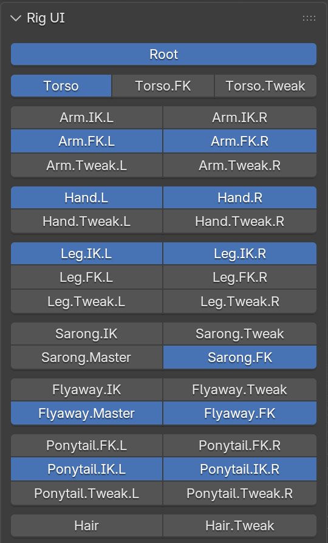

# Rig UI (Collections)

Buttons for showing and hiding the rig's bone collections.

**Where:** n-Panel > Item > Rig UI (armature, or a mesh deformed by the armature)
{ .where }

## Overview

The Rig UI panel shows a toggle button for each bone collection, so animators can quickly hide or show FK controls, IK controls, tweaks, and so on.  It works with the armature selected, and also with one of the character's meshes selected.

New bone collections are added to the bottom of the panel automatically.  Bone collections whose parent collection is hidden in Blender aren't shown.

The button layout is stored on the armature, so it's saved with the rig and shared with anyone who uses it.  The layout is separate from Blender's bone collection list; rearranging or hiding buttons in the Rig UI doesn't change the order or visibility of the bone collections themselves.

<figure markdown="span">
    { width="240" }
    <figcaption>A finished character's Rig UI.</figcaption>
</figure>

### Assembly bone collections

Assemblies put their controls into bone collections named after the limb and side.  For example, an arm on the left side creates collections for its FK controls, IK controls, and tweaks, such as `Arm.FK.L`, `Arm.IK.L`, and `Arm.Tweak.L`.  Mechanism bones go into MCH collections, grouped under a parent **MCH** collection.

Assemblies that share a limb name and side share the same collections.  For example, the left shoulder goes in with the left arm, and the left palm and fingers share the left hand collections.

The collections for a limb can be renamed from the *[Assembly Panel](../assemblies.md#assembly-panel)*.  Click the collection icon next to the assembly name, and enter the new names.  The Rig UI layout is updated to match.

## Editing the layout

!!! note
    Editing needs the full RigTools add-on.  With the embedded script or the RigTools UI add-on, the panel shows the layout but has no **Edit** button.

Click **Edit** to rearrange the buttons.  In edit mode, clicking a button selects it instead of toggling the collection.  With a button selected:

| Button | Action |
| --- | --- |
| Gap | Add a gap (blank space) above the selected row. |
| Row up / Row down | Move the collection to its own row above or below. |
| Join up / Join down | Move the collection onto the row above or below. |
| ◀ / ▶ | Move the collection left or right within its row. |
| ▾ menu | Rename the bone collection, or Hide/Show it in the Rig UI. |

Gaps can be selected, moved with Row up / Row down, and removed with the **X** button next to them.

Renaming from the Rig UI renames the actual bone collection, and keeps the assemblies that use it up to date.  Renaming to the name of another collection merges the two: the bones and child collections are moved into the existing collection, and the renamed one is removed.  Everything else in edit mode only changes the layout.

Hidden collections are shown greyed out in edit mode, and aren't shown at all outside of edit mode.  Hiding is useful for collections that animators should never need, like MCH, ORG, and DEF.

Click **Edit** again to finish editing.

!!! screenshot "Image placeholder"
    `image/rig_ui_edit.png` — The Rig UI panel in edit mode, with one collection selected and the row/join/shift buttons, its dropdown menu, and a selected gap visible.

## Related

- [Rig UI](../rig_ui.md)
- [Rig Properties](properties.md)
- [Visibility](visibility.md)
- [Assemblies](../assemblies.md#assembly-panel)
