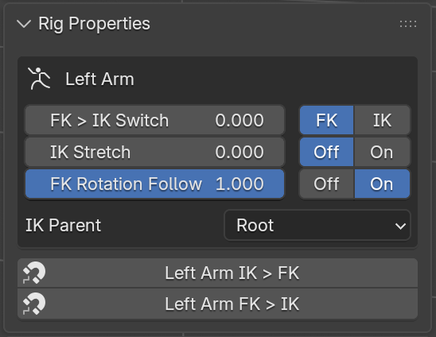

# Rig Properties

!!! info
    This is AI-generated documentation that has not yet been human reviewed.

Shows the animator controls for the selected limb: FK/IK switching, IK parents, rotation follow, and so on.

**Where:** n-Panel > Item > Rig Properties (armature selected)
{ .where }

## Overview

The Rig Properties panel shows the properties for every assembly that the selected bones belong to.  Select a hand control, and the arm's properties are shown.  Select several controls, and the properties for each limb are shown together, grouped by limb (for example, "Left Arm" and "Right Arm").  When X-Axis Mirror is enabled in Pose mode, the opposite limb is shown as well.

The properties are stored on the *[property bone](../armature_settings.md#property-bone)*, so they can be keyframed like any other custom property.  When auto keying is on, clicking one of the buttons next to a property inserts a keyframe.

<figure markdown="span">
    { width="360" }
    <figcaption>A left arm control selected: the arm's switches and IK parent, plus its snap buttons.</figcaption>
</figure>

## Properties

Most properties are a slider with buttons next to it.  The buttons set the property all the way to one side; the slider allows anything in between.

| Property | Buttons | Description |
| --- | --- | --- |
| FK > IK Switch | FK / IK | Switches the limb between FK and IK.  See *[FK/IK Switching](../tools/fk_ik_switch.md)*. |
| IK Stretch | Off / On | Allows the IK chain to stretch past its full length.  See *[Standard IK](../tools/standard_ik.md)*. |
| FK Rotation Follow | Off / On | Whether the first FK control follows its parent's rotation.  See *[Rotation Isolation](../tools/rotation_isolation.md)*.  The torso has separate **Neck** and **Head** versions. |
| Leg Collision | Off / On | Turns skirt collision on or off.  See *[Skirt Collision](../tools/skirt_collision.md)*. |
| Leg Ride | Off / On | Turns skirt ride on or off.  See *[Skirt Ride](../tools/skirt_ride.md)*. |
| IK Parent | (dropdown) | What the IK controls follow.  See *[IK Parent Switching](../tools/ik_parent.md)*. |

## Snapping

Arm and Leg assemblies include FK <> IK snapping.  Two buttons are shown below the limb's properties:

- **IK > FK**: moves the IK control and pole to match the current FK pose, then switches the limb to IK.
- **FK > IK**: rotates the FK controls to match the current IK pose, then switches the limb to FK.

Use these when changing modes mid-animation, so the limb doesn't jump.

!!! note
    Snapping is not available for the spline IK assemblies.  A spline IK pose often can't be matched by an FK chain.

!!! tip
    Snapping doesn't insert keyframes.  Keyframe the controls and the FK > IK Switch property after snapping.

## Related

- [Rig UI](../rig_ui.md)
- [Collections](collections.md)
- [Visibility](visibility.md)
- [Armature Settings](../armature_settings.md#property-bone)
