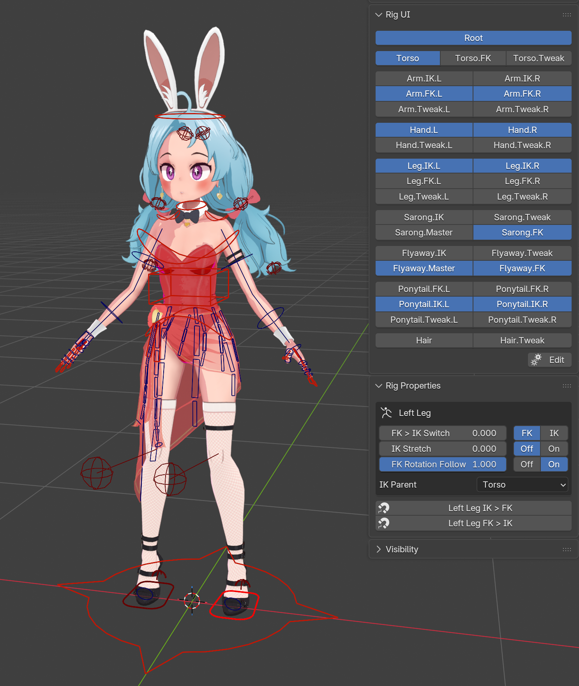

# Workflow
<figure markdown="span">
    { width="360" }
    <figcaption>A finished rig in Pose mode, with the Rig UI and Rig Properties panels open.</figcaption>
</figure>

1. Create the initial rig skeleton: 

    **Add > Armature > RigTools Human Skeleton**
    { .where }

    Use this base skeleton, customize it, and fit it to your character, or create the skeleton manually. 

2. [Optional] Add twist bones 

    **n-Panel > RigTools > Tools > Add Twist Bones**
    { .where }

    Create twist bones on the arm, legs, chest, and neck as desired.
    These can also be created manually.  See *[twist bones](twist_bones.md)* for more information. 

3. Weight paint the character 

    Weight paint the character as you normally would.  This can be done manually or with standard Blender tools.
    The *[weight paint proxy](operators/weight_paint_proxy.md)* tool might help in some niche cases. 

4. Create the ORG bones 

    **n-Panel > RigTools > Tools > Generate ORG Bones**
    { .where }

    See *[Generate ORG Bones](operators/generate_org_bones.md)* for more details.
    This tool duplicates every DEF bone and creates a Copy Transforms constraint from the ORG bone to the DEF bone. 

5. Create the Torso assembly 

    **n-Panel > RigTools > Forward Kinematics > Torso**
    { .where }

    Select the torso bones, neck, and head (excluding twist bones) and create the torso assembly.
    See *[torso assembly](fk_assemblies.md#torso)* 

6. Create the Arm and Leg assemblies 

    **n-Panel > RigTools > Inverse Kinematics > Arm** and **Leg**
    { .where }

    See *[ik_assemblies](ik_assemblies.md)* for more information

7. Create additional assemblies as desired.

    Add shoulder, palm, and finger assemblies if desired.  Add assemblies for hair, cloth, tails, etc.
    Use "FK only" for short detail chains, or "Simple FK" if you want tweak controls.

8. Set up the Rig UI 

    **n-Panel > Item > Rig UI**
    { .where }

    Arrange the collection buttons, and hide the collections animators don't need, like MCH and ORG.
    See *[Rig UI](rig_ui.md)*. 

9. [Optional] Check the rig's data 

    **Properties > Armature > RigTools > Check Data**
    { .where }

    Run Check Data to find anything RigTools remembers that's no longer on the rig, such as renamed bones or deleted collections.
    See *[Data Viewer](data_viewer.md)*. 

10. Hand the rig off to animators 

    **n-Panel > RigTools > Tools > Embed Animator UI**
    { .where }

    Embed the Rig UI script in the file so animators see the Rig UI panels without installing RigTools.
    Or have animators install the **RigTools UI** add-on instead.
    See *[Sharing with Animators](rigui/animators.md)*. 

## Related

- [Inverse Kinematics Assemblies](ik_assemblies.md)
- [Forward Kinematics Assemblies](fk_assemblies.md)
- [Twist Bones](twist_bones.md)
- [ORG & DEF](org_def.md)
- [Rig UI](rig_ui.md)
- [Data Viewer](data_viewer.md)
- [Sharing with Animators](rigui/animators.md)

